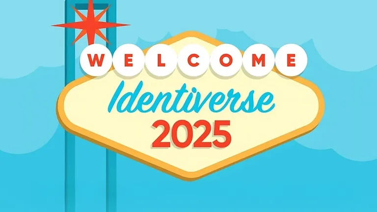

+++
title = "FIDO Passkeys Masterclass Panel @ Identiverse 2025"
date = "2025-06-02T17:00:00.000Z"
description = "I make a guest appearance during FIDO's hosted masterclass about passkeys and digital credentials!"
categories = ["presentations"]
keywords = []
hasCode = false
exclude_from_rss = true
+++

# Description

As digital interactions become more complex, personal identity is at the center of security, privacy, and trust. Traditional identity models often fail to balance security with user autonomy, leading to over-reliance on centralized data, privacy risks, and friction in digital experiences. This workshop explores the evolution of personal identity, focusing on standards surrounding mdocs and verifiable credentials, decentralized identity, as well as self-sovereign identity (SSI). Attendees will learn how to navigate the shift toward user-controlled identity models while ensuring compliance, security, and interoperability in a rapidly evolving landscape.
