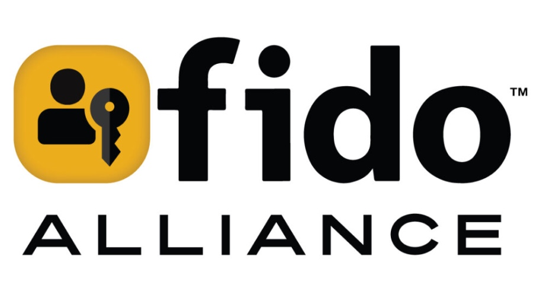

+++
title = "FIDO Summer Camp 2025: Trust Signals​ (webinar)"
date = "2025-07-01T17:00:00.000Z"
description = "A webinar exclusively for FIDO Alliance members covering REDACTED"
categories = ["presentations"]
keywords = []
hasCode = false
exclude_from_rss = true
+++

# Description

This webinar series was exclusive to FIDO Alliance members so unfortunately I can't really go into too much detail here or share the recording.
