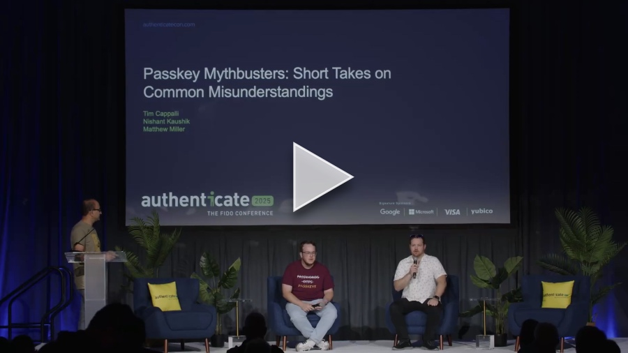

+++
title = "Passkey Mythbusters: Short Takes on Common Misunderstandings @ Authenticate 2025"
date = "2025-10-13T17:00:00.000Z"
description = "Clearing up some rumors about synced passkeys that just wouldn't go away. Rated a Top 10 session at Authenticate 2025!"
categories = ["presentations"]
keywords = []
hasCode = false
exclude_from_rss = true
+++

# Description

Passkeys promise to replace passwords with a simpler, more secure login experience, but myths and confusion still hold many organizations back. Do passkeys lead to vendor lock-in? Are passkeys not appropriate for workforce scenarios? Can passkeys be stolen?  In this session, we’ll tackle some commonly heard questions and misconceptions about passkeys, breaking down the facts in clear, practical terms. You’ll walk away with a solid understanding of what passkeys really solve, what they don’t, and how to approach adoption with confidence.
