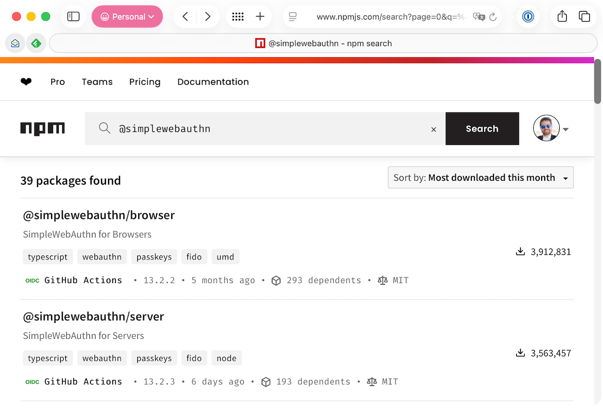
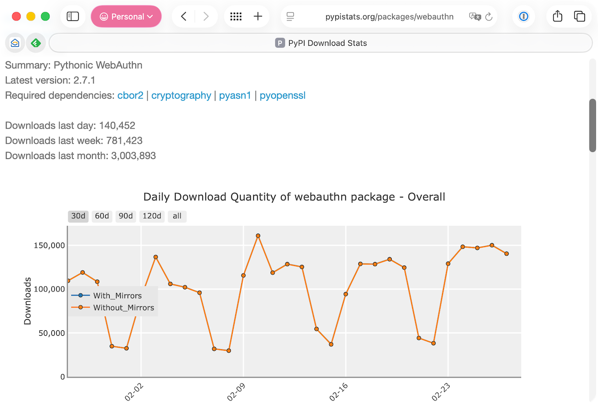

+++
title = "How many WebAuthn library downloads a month?!"
date = "2026-02-28T02:48:10.049Z"
description = "A quick SimpleWebAuthn and py_webauthn popularity check vis-a-vis number of downloads over the last 30 days."
categories = ["webauthn"]
keywords = []
hasCode = false
+++

I spotted Anthropic's offer of [six free months of Claude Max 20x](https://claude.com/contact-sales/claude-for-oss) for open-source maintainers today. It was thanks to having access to Claude Opus 4.6 this week at work that I was able to vibe code a POC passkey provider app for iOS into existence (a topic for another post perhaps.) I have to admit the experience shifted me from AI skeptic to AI-intrigued. It turns out Claude has come a long way since I last used it a couple of years ago to one-shot some tiny JavaScript utilities. So I decided to apply for some free Claude access for my own personal use.

## Eligibility Requirements

Setting aside the fact that Anthropic is being _incredibly_ stingy in only offering six months of free Claude to FOSS maintainers when my and many others' open-source work is undoubtedly part of Claude/Opus/Haiku's training data [which now earns Anthropic _billions of dollars in ARR_](https://www.anthropic.com/news/anthropic-raises-30-billion-series-g-funding-380-billion-post-money-valuation), I dug into the core eligibility requirements:

> - You are a primary maintainer or core team member of at least one public repository hosted on GitHub;
> - That repository has 5,000 or more GitHub stars or 1M+ monthly NPM downloads;

## SimpleWebAuthn Downloads

[SimpleWebAuthn](https://simplewebauthn.dev) is my most popular open source project by far, but even after all this time it's still only accumulated around 2,200 stars. So I went looking for [monthly download figures on NPM](https://www.npmjs.com/search?page=0&q=%40simplewebauthn&sortBy=downloads_monthly) for the project's two libraries. The numbers astounded me:

According to NPM, **@simplewebauthn/browser** has been downloaded **more than 3.9 million times** in the last 30 days! And **@simplewebauthn/server** isn't too far behind at **over 3.5 million downloads** in the same period! That's mind-blowing!

## py_webauthn Downloads

At this point I figured what the heck, let's see how the other FOSS WebAuthn library I maintain through work, [py_webauthn](https://github.com/duo-labs/py_webauthn) (aka the ["webauthn"](https://pypi.org/project/webauthn/) package in PyPI 👨‍🍳💋), compared via [pypistats.org](https://pypistats.org/packages/webauthn):

**Just over 3 million downloads** in the last 30 days! Wild...

## What the numbers really mean

I decided to write this post after looking at these download stats, writing the following rationale in my Claude freebie application, then reflecting on what significant accomplishments I'd just blithely summarized:

> My @simplewebauthn libraries have been downloaded from NPM 3,500,000+ times each in the last month. I also maintain https://pypi.org/project/webauthn/ @ 3,000,000+ downloads in the last 30 days, and also webauthn.io which lots of people tell me they use daily to keep tabs on the evolution passkeys.

But as far as metrics go, "downloads over the last 30 days" is a pretty coarse-grained one because things like "downloading the library in a CI unittest pipeline as a second-level dependency of another library prior to deployment" and "[installing it while following a Google guide to implementing passkeys](https://developers.google.com/identity/passkeys/developer-guides/server-registration)" contribute to the total. That's why this metric is impossible to use to gauge something like "number of unique projects using the library."

It's one of the few measurable metrics available to me and others to gauge how useful others find my work, though, so I'll take it. If nothing else I'm letting this post be a snapshot of download figures, as of February 2026, for what I consider to be some of my most meaningful FOSS work thus far 😌
